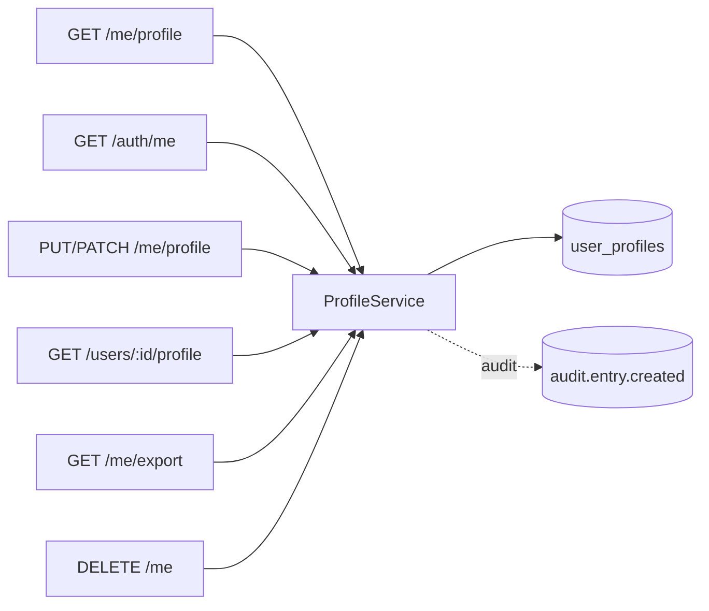

# Architecture Spine — Extendable User Profiles

## Design Paradigm

**Layered monolith with transactional services + event-published audit, mirrored on the web by Refine dataProvider → hooks → pages.**

- **API:** `FastAPI routes (apps/api/src/api/routes/*)` → `Services (apps/api/src/services/*)` → `Models + Session (apps/api/src/db/session.py, apps/api/src/models/*, apps/api/src/db/base.py)` → `Postgres/pgserver`. Services own transactions; routes are thin and auth-gated. Side-effects (audit) are published on `EventBus` (`src/events/bus.py`, `src/events/subjects.py`) to the single workqueue stream `SAAS_TEMPLATE`; no new subjects. `Container` provides `SessionFactory` + `bus`.
- **Web:** `Refine (5.0.12) + react-router` with `dataProvider` (wraps `@refinedev/simple-rest` over `/api/v1`) → `hooks (useCustom/useList/useCreate)` → `pages/components`. `useProfile` is a thin wrapper; no raw `fetch` outside `dataProvider`. Forms via `@refinedev/react-hook-form` + `zodResolver` + `shadcn/ui` primitives; existing `queryClient` keys.

This paradigm is adopted from the running codebase (`apps/api/src/main.py:12`, `docs/ARCHITECTURE.md:2`) — the spine ratifies it, not reinvents it.

```mermaid
flowchart TB
  subgraph API["API — layered"]
    R[routes/\nprofiles.py, auth.py] --> S[services/\nprofiles.py, auth.py]
    S --> M[models/\nprofile.py + workspace.py]
    M --> DB[(Postgres / pgserver)]
    S -. publish .-> BUS[(EventBus\nSAAS_TEMPLATE\naudit.entry.created)]
    BUS -. consume .-> WF[workflows\n(audit log)]
  end
  subgraph WEB["WEB — Refine"]
    P[pages /settings/profile] --> H[hooks\nuseProfile / useUpdateProfile\n+ getProfileField]
    H --> DP[dataProvider\n/api/v1]
    DP --> API
  end
```

## Invariants & Rules

### AD-1 — Layered ownership, service owns the transaction

- **Binds:** all FRs, `apps/api/src/api/routes/*`, `apps/api/src/services/*`, `apps/api/src/db/session.py`
- **Prevents:** routes issuing raw SQL or committing outside a service; web bypassing `dataProvider`
- **Rule:** HTTP handlers validate and authorize, then delegate to a service that owns the `AsyncSession` boundary (flush/commit/rollback). Services may `publish_audit` but never start an HTTP response. Web reads/writes profiles exclusively via `dataProvider`/`useCustom` (relative URLs under `/api/v1`); direct `fetch`/`axios` to profile paths is forbidden.

### AD-2 — UserProfile is a separate 1:1 table, not a column on users

- **Binds:** FR-1, FR-2, FR-16
- **Prevents:** migrating hot `users` table, polluting the 13-importer `workspace.py`, or coupling to future `Agent` tables
- **Rule:** New table `user_profiles` — `user_id` is the PK and a `FK users.id ON DELETE CASCADE UNIQUE`, plus `first_name`, `last_name`, `bio`, `phone_number`, `timezone`, `locale`, `date_of_birth`, `website_url`, `location`, `custom_data JSON NOT NULL DEFAULT '{}'`, `created_at/updated_at` via `TimestampMixin`. No FK to `workspaces`. No reuse for `Agent` — agents will own `agents` / `agent_profiles` separately. Provisioned eagerly on `AuthService.register`/`upsert_oauth_user` and idempotently via `ProfileService.get_or_create` (used by both `GET /me/profile` and `GET /auth/me`).

```mermaid
erDiagram
  users ||--|| user_profiles : "user_id PK/FK CASCADE"
  users ||--o{ workspace_members : "user_id"
  workspace_members }o--|| workspaces : "workspace_id"
  users ||--o{ refresh_tokens : "user_id"
  user_profiles {
    string user_id PK FK
    string first_name
    string last_name
    string bio
    string phone_number
    string timezone
    string locale
    date date_of_birth
    string website_url
    string location
    json custom_data
    datetime created_at
    datetime updated_at
  }
```

### AD-3 — custom_data is JSON Merge Patch (RFC 7396), bounded

- **Binds:** FR-3, FR-5
- **Prevents:** divergent merge/replace/delete semantics across endpoints or forks
- **Rule:** `PATCH /me/profile` shallow-merges `custom_data`: existing keys outside payload are retained; a key with value `null` deletes it; omission preserves. `PUT /me/profile` with an explicit `custom_data` replaces the bag entirely (omit the key to leave it unchanged). Both paths validate after merge: `custom_data` must be `dict[str, JSON-serializable]`, `len(keys) ≤ 50`, `len(json.dumps(custom_data)) ≤ 16 KiB` (tunable via settings). Empty bag is `{}`. No per-key schema/Index/GIN in v1; validation is size + serializability only.

### AD-4 — Two-file extension seam

- **Binds:** FR-8, FR-9, FR-10, FR-4
- **Prevents:** forks editing shared helpers, serializers, or `ProfileService` to add a field
- **Rule:** Adding a first-class field requires only: (1) backend — add column to `UserProfile` (`apps/api/src/models/profile.py` — new file) + add optional field to `ProfileRead`/`ProfileUpdate` in `apps/api/src/schemas/api.py` + Alembic migration; (2) frontend — add optional property to `UserProfile` in `apps/web/src/types.ts`. `ProfileService`, serializers, and `getProfileField` need no edits — top-level-first lookup already exposes new columns. Unknown top-level keys on inbound payloads are `422` (`extra="forbid"`); only `custom_data` is open. Promotion: migration may `UPDATE user_profiles SET new_col = custom_data->>'key'` where `jsonb_exists`.

### AD-5 — Auth surface, embed, and cross-user guard

- **Binds:** FR-5, FR-6, FR-7, FR-11
- **Prevents:** org-wide profile enumeration, PII leakage, or a second auth scheme
- **Rule:** All profile routes behind `get_current_user` (JWT `sub`). `GET /auth/me` always returns `{ ..., profile: UserProfile }` (lazy `get_or_create` inside the same `Session`). `GET /me/profile` and `GET /auth/me` share the same serialization. `GET /users/{user_id}/profile` succeeds only if requester and target share a `workspace_members` row (`status=active`) or requester is `is_superuser`; otherwise `404` (not `403`) to avoid enumeration. Cross-user projection redacts `phone_number`, `date_of_birth`, and any `custom_data` key with prefix `_private_` in the serializer (storage retains them). `avatar_url` remains `users.avatar_url` (nullable, may be empty string); no upload path.

### AD-6 — Frontend data contract

- **Binds:** FR-4, FR-11, FR-12
- **Prevents:** hand-rolled fetch, divergent accessors, or SPA routing 404s
- **Rule:** `apps/web/src/types.ts` exports `type UserProfile = { id: string; user_id: string; first_name?: string|null; ...; custom_data: Record<string,unknown>; created_at?: string; updated_at?: string; } & Record<string,unknown>` plus `export function getProfileField(p: UserProfile, key: string, fallback?: unknown): unknown` (column-first, then `custom_data[key]`, then `fallback`). `useProfile()` and `useUpdateProfile()` wrap `useCustom`/`useCustomMutation` to `/me/profile` (relative to `/api/v1`) and invalidate both `["profile","me"]` and `["auth","me"]` (the embedded identity). `/settings/profile` is a settings route (not a Refine resource `create`) using `useForm` + `zodResolver` + shadcn `FormField/FormItem/FormLabel/FormControl/FormMessage`; `custom_data` editor sends `null` to delete keys. Vite proxy rule `"/api/"` (trailing slash) must stay — prevents swallowing SPA routes like `/api-keys`.

### AD-7 — Audit, export, and delete are lifecycle-closed

- **Binds:** FR-13, FR-14, FR-15, FR-16, Cross-cutting NFRs
- **Prevents:** silent mutations, unbounded exports, or orphaned profile rows
- **Rule:** Every `PUT/PATCH /me/profile` publishes `audit.entry.created` (existing `SAAS_TEMPLATE` workqueue, same as today) with `resource_type="user_profile"`, `resource_id=user_id`, `action="profile.updated"`, `details={ changed_fields: string[] }` — never raw PII values. Exports (`GET /me/export`, and superuser `GET /users/{id}/export`) are synchronous JSON bundles `{ exported_at, user, profile, workspaces:[...], counts:{ audit_entries, notifications } }` with `Content-Disposition: attachment`; secrets (`password_hash`, refresh token hashes, key material) are excluded. Delete (`DELETE /me` with `{ password?, confirm: "DELETE" }` — password required when `password_hash` exists; superuser `DELETE /users/{id}`) hard-deletes `users` (FK cascades to `user_profiles`; service explicitly deletes `refresh_tokens`, `workspace_members`, etc., within one transaction, revokes sessions, publishes `audit.entry.created action="user.deleted"`) and returns `204`; subsequent `GET /auth/me` is `401`. No profile PII at `INFO` logs (log `user_id` + `changed_keys` only).

### AD-8 — No coupling to future Agent domain

- **Binds:** FR-2, FR-8, Non-Goals
- **Prevents:** polymorphic reuse of `user_profiles` for non-human agents
- **Rule:** `user_profiles` is exclusively for `users`. Planned `Agent` entities will own separate `agents` and `agent_profiles` tables; no code in this feature may import, reference, or assume an `Agent` type. Keeping the seam empty is the invariant — a later `AgentProfile` PRD will cite AD-8 and add its own tables/helpers without touching this seam.

## Consistency Conventions

| Concern | Convention |
|---|---|
| Naming (entities, files, interfaces, events) | Table `user_profiles`, model `UserProfile`, service `ProfileService`, route module `profiles.py`, schemas `ProfileRead/ProfileUpdate/ProfileExport`, hook `useProfile`. Existing `audit.entry.created` subject reused — no new subjects. |
| Data & formats (ids, dates, error shapes, envelopes) | Ids `StringUUID` (asyncpg `UUID`, SQLite `CHAR(36)`), timestamps `DateTime(timezone=True)` ISO-8601, errors FastAPI `detail` string via `error.message` on web (suppress duplicate toasts). Profile payload always contains `custom_data: Record<string,unknown>` even when empty. |
| State & cross-cutting (mutation, errors, logging, config, auth) | Services own transactions, idempotent `get_or_create` handles races via `ON CONFLICT DO NOTHING`/retry; audit is `publish_audit(bus, workspace_id=None, resource_type=...)`. PII redaction in serializer; logs emit `user_id` + `changed_fields` only. All profile routes behind `get_current_user`; cross-user guard checks `workspace_members.status=active`. No new config keys (bounds use existing settings style; env overrides via `Settings`). |

## Stack

| Name | Version |
|---|---|
| Python | >=3.12 (from pyproject) |
| fastapi | >=0.115 |
| sqlalchemy[asyncio] | >=2.0 |
| alembic | >=1.14 |
| pydantic / pydantic-settings | >=2.9 / >=2.6 |
| asyncpg / aiosqlite | >=0.30 / >=0.20 |
| pyjwt | >=2.10 |
| pgserver | >=0.1.4 (dev) |
| React | ^18.3.1 |
| @refinedev/core / @refinedev/react-router | 5.0.12 / 2.0.4 |
| @refinedev/react-hook-form | ^5.0.4 |
| @refinedev/simple-rest | ^6.0.1 |
| react-hook-form / zod / @hookform/resolvers | ^7.57 / ^3.25.76 / ^5.9.0 |
| typescript / vite / @vitejs/plugin-react | ^5.6.3 / ^5.4.11 / ^4.3.3 |
| @tanstack/react-query | ^5.59.0 |
| shadcn/ui + tailwindcss | tailwind ^3.4.17 (existing) |

## Structural Seed

```text
apps/api/
  alembic/versions/0006_user_profiles.py   # create user_profiles + backfill
  src/
    models/
      profile.py         # UserProfile (new) — 1:1 users
      workspace.py       # User (unchanged, avatar_url nullable/empty)
    schemas/
      api.py             # ProfileBase / ProfileRead / ProfileUpdate / ExportBundle / DeleteMeRequest
    services/
      profiles.py        # ProfileService.get_or_create / update / export_bundle / delete_account
      serializers.py     # profile_to_dict + redacted public_projection
    api/routes/
      profiles.py        # GET/PUT/PATCH /me/profile, GET /users/{id}/profile, GET /me/export, DELETE /me
      auth.py            # GET /auth/me — now embeds profile (mod)
apps/web/
  src/
    types.ts             # UserProfile + getProfileField (+ Identity.profile)
    hooks/useProfile.ts  # useProfile / useUpdateProfile / useExportProfile / useDeleteAccount (new)
    pages/settings/ProfileSettingsPage.tsx  # /settings/profile (new, shadcn Form)
    App.tsx              # route registration (mod)
```



```mermaid
flowchart TB
  subgraph Owners["Data owners (one writer)"]
    U[users\n(AuthService)] --> P[user_profiles\n(ProfileService)]
  end
  U -. FK CASCADE .-> P
  P -. cross-user read .-> WM[workspace_members\n(read-only guard)]
  E[export / delete\n(ProfileService)] --> U
  E --> P
```

**Test strategy (seed):** model idempotency (concurrent `get_or_create`), Pydantic validation (limits + `extra=forbid`), service merge/delete/bounds (null-deletes, size caps), serializer redaction (cross-user), route coverage (`/me/profile`, `/auth/me` embed, `users/{id}/profile` 404 on non-co-member, `export` without secrets, `delete` cascade + 401 afterwards), frontend `getProfileField` + `ProfileSettingsPage` form submit 422 single-toast, plus the **extendability invariant** test (add column → `PATCH` new field → `getProfileField` sees it without helper edits).

## Capability → Architecture Map

| Capability / Area | Lives in | Governed by |
|---|---|---|
| Profile model & lifecycle (FR-1, FR-2, FR-16) | `models/profile.py`, migration, `services/profiles.py::get_or_create`, `services/auth.py` hooks | AD-2, AD-1 |
| Schemaless metadata (FR-3, FR-4) | `models/profile.py:custom_data`, `schemas/api.py:ProfileUpdate`, `services/profiles.py::update` | AD-3, AD-4 |
| Own-profile read/write + embedded identity (FR-5, FR-11) | `api/routes/profiles.py`, `api/routes/auth.py:GET /auth/me`, `services/serializers.py`, `types.ts`, `hooks/useProfile.ts` | AD-5, AD-6 |
| Cross-user read, workspace-bounded (FR-6, FR-7) | `services/profiles.py::get_public_projection`, serializer redaction, `workspace_members` guard | AD-5 |
| Template extendability seam (FR-8, FR-9, FR-10) | `models/profile.py`, `schemas/api.py`, `types.ts`, docs | AD-4, AD-6 |
| Settings UI (FR-12) | `pages/settings/ProfileSettingsPage.tsx`, shadcn Form + zod | AD-6 |
| Audit / export / delete (FR-13, FR-14, FR-15) | `services/profiles.py`, `events/publisher.py`, `api/routes/profiles.py` | AD-7 |
| Agent separation (Non-Goal) | — (future `agents`/`agent_profiles`) | AD-8 |

## Deferred

- **Avatar upload & storage** — deferred; `avatar_url` stays a nullable URL string (may be empty). Choice of storage (S3/MinIO/DB) and processing can wait until a fork needs it; no seam pre-claimed now.
- **GIN / per-workspace search over `custom_data`** — deferred (including indexes and validation registries); would add `jsonb` indexing and a search contract not needed for MVP. `custom_data` is intentionally not indexed (AD-3).
- **Field-level RBAC / per-key visibility flags** — deferred; cross-user projection is fixed redaction (AD-5), not a permission matrix. A future `profile:read_private` or per-field flag would own this.
- **Realtime (WebSocket) profile push** — deferred; clients refetch or invalidate `["auth","me"]` (AD-6). Adding an `EventBus` transient fan-out later does not affect the table contract.
- **Async/bulk audit export** — `GET /me/export` is synchronous snapshot with counts (AD-7); streaming full audit history is a workspace-admin concern, not this feature.
- **Multi-workspace / workspace-scoped profiles** — profile remains global per user (AD-2); a future `workspace_member_profiles` epic would cite Deferred and add its own guard without altering `user_profiles`.
- **Infra/provider topology** — no new infra; inherits `DATABASE_URL` / `EVENT_BUS_DRIVER=inprocess|nats` exactly as `docs/ARCHITECTURE.md:6` specifies. Operational envelope is not re-decided here.
