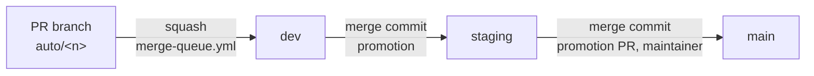

# Fleet process

The fleet is a set of agents and GitHub workflows that move a change from an issue to a
release. All fleet work happens in GitHub: issues, labels, pull requests and milestones. This
page is the single document for the process: how to turn it on, what each workflow does, which
credentials it uses, the branch model, the label contract, the manual fallbacks and the
`specs/` convention.

The fleet is off by default. The generic checks in `ci.yml` and `e2e.yml` run in every
repository. The fleet workflows and fleet jobs run only when the repository variable
`FLEET_WORKFLOWS` is `true`.

## Opt in

1. **Variable.** Set the repository variable `FLEET_WORKFLOWS` to `true`
   (Settings, Secrets and variables, Actions, Variables), or:

   ```bash
   gh variable set FLEET_WORKFLOWS --body true
   ```

   Every fleet job has `if: vars.FLEET_WORKFLOWS == 'true'`. Without the variable the jobs are
   skipped and the repository behaves as a plain CI repository.

2. **Secret.** Create the repository secret `FLEET_TOKEN` (see [Credentials](#credentials)):

   ```bash
   gh secret set FLEET_TOKEN
   ```

   `merge-queue.yml` is the only workflow that needs it.

3. **Branches.** Create `dev` and `staging` from `main`:

   ```bash
   git push origin main:dev main:staging
   ```

   GitHub starts `schedule` and `workflow_run` triggers only from the workflow files on the
   default branch. `merge-queue.yml` uses both, so it must exist on the default branch.
   Until promotion to `main` is running, the default branch is `dev`. After the first
   promotion lands, switch the default branch to `main`.

4. **Labels.** Create every label the fleet reads or sets:

   ```bash
   for l in agent:triage agent:groom agent:build agent:docs agent:spec agent:plan \
            agent:plan-build agent:plan-check agent:split agent:research agent:retro \
            agent:area-map agent:review agent:verify agent:merge agent:revise \
            agent:ci-fix agent:rebase agent:done in-progress review-in-progress \
            needs-human backlog wontfix invalid duplicate P0 P1 P2; do
     gh label create "$l" 2>/dev/null || true
   done
   ```

   `needs-human` must exist before `branch-guard.yml` runs, because the workflow opens its
   violation issue with that label. The meaning of each label is in
   [Consumed labels](#consumed-labels).

5. **Repository settings.** Turn off rebase merge and turn on deletion of merged branches:

   ```bash
   gh api -X PATCH repos/{owner}/{repo} -F allow_rebase_merge=false -F delete_branch_on_merge=true
   ```

   `delete_branch_on_merge` deletes the head branch of a merged PR. A promotion PR from
   `staging` to `main` would delete `staging`. Open promotions from a throwaway branch, or
   exclude `staging` from branch deletion, before a promotion PR is merged.

6. **Open PRs against `dev`.** Fleet agents branch from `dev` and open PRs with `--base dev`.
   Retarget existing open PRs with `gh pr edit <n> --base dev`.

## Workflow reference

"Generic" means the check is useful without the fleet and runs without the variable.
"Fleet" means it assumes the fleet process and is skipped unless `FLEET_WORKFLOWS` is `true`.

### Workflows

| Workflow | What it does | Needs | Kind | Adopt on its own |
|---|---|---|---|---|
| `ci.yml` | Runs the jobs listed below on pushes to `dev`, `staging` and `main`, on PRs into `dev` and `main`, and when called by another workflow with a `sha` input. | Nothing. Read-only `contents` permission. | Generic, with four fleet jobs | Copy the file. Delete the `branches:` lists if your branches differ. Every checkout uses `inputs.sha \|\| github.sha`, so remove the `workflow_call` block if no workflow calls it. Delete the four fleet jobs, or keep them and set the variable. |
| `e2e.yml` | Runs the web Playwright suite on pushes to `main`, on PRs into `main`, on manual dispatch and when called with a `sha` input. | Nothing. | Generic | Copy the file. Change `branches: [main]` to your integration branch. |
| `merge-queue.yml` | Squash-merges approved PRs into `dev`, one per run, and reverts a squash commit that turns `dev` CI red. Runs `scripts/merge_queue.py`. | `FLEET_TOKEN`; labels `agent:merge`, `agent:revise`, `agent:rebase`, `agent:ci-fix`, `agent:review`, `P0`; branch `dev`; a workflow named `ci` that runs on pushes to `dev`; `Area:` and `Release-note:` lines in PR bodies. | Fleet | Copy the workflow and `scripts/merge_queue.py`. Delete the job's `if:` line. Set `FLEET_TOKEN`. The script constants `INTEGRATION_BRANCH`, `MERGE_LABEL`, `P0_LABEL`, `VALID_AREAS` and `GATE_LABELS` hold the branch, labels and areas. `--base` overrides the branch. `--enforce-approval` makes the approval gate blocking. `--dry-run` prints the decisions and changes nothing. |
| `branch-guard.yml` | Checks every push to `dev`, `staging` and `main` against the branch model and, on a violation, opens or updates one `needs-human` issue. Runs `scripts/branch-guard.sh`. | Default `GITHUB_TOKEN` with `contents: read`, `issues: write`, `actions: read`; label `needs-human`; the three branches. | Fleet | Copy the workflow and `scripts/branch-guard.sh`. Delete the job's `if:` line. The branch names are in the workflow `branches:` list and in the `case` statements of the script. |
| `source-guard.yml` | Fails a PR into `main` unless its head is the same-repository `staging` branch, retargets other PRs to `dev` and posts one guidance comment. Runs `scripts/source-guard.sh`. | Default `GITHUB_TOKEN` with `pull-requests: write`; branches `main`, `dev`, `staging`. | Fleet | Copy the workflow and `scripts/source-guard.sh`. Replace `if: vars.FLEET_WORKFLOWS == 'true' && ...` with the base-branch condition alone. `main`, `staging` and `dev` are named in the workflow and the script. Mark `source-guard` as a required check where branch protection exists. |

### Jobs in `ci.yml`

| Job | What it runs | Kind | Adopt on its own |
|---|---|---|---|
| `api-lint` | `ruff check` and `ruff format --check` in `apps/api` | Generic | Copy the job. |
| `api-test` | `pytest` in `apps/api` | Generic | Copy the job. |
| `db-check` | `make db-check` (migration heads and model drift) | Generic | Copy the job and `scripts/db-check.sh`. |
| `template-paths` | In a repository created from the template: reports template-owned files changed since the last template sync (advisory). In the template repository: runs the script self-test. | Generic | Copy the job and `scripts/check-template-paths.sh`. The job compares the repository name with the template's name. |
| `web` (checks `web-build`, `web-test`, `web-e2e`) | One matrix over `npm run build`, `node --test` with a non-zero test count, and `npm run test:e2e` in `apps/web` | Generic | Copy the job. Remove matrix entries you do not need. |
| `trailing-newline` | Fails when a tracked `*.ts`, `*.tsx`, `*.py`, `*.sh` or `*.md` file has no final newline | Generic | Copy the job. |
| `branch-guard-test` | `bash scripts/branch-guard.test.sh` (fixture repository, no network) | Fleet | Delete the `if:` line. Copy with `branch-guard.yml`. |
| `label-contract` | `scripts/check-label-contract.sh` (see [Consumed labels](#consumed-labels)) | Fleet | Delete the `if:` line. Copy with `docs/FLEET.md` and the `.agents/` briefs. |
| `release-notes` | `bash scripts/release-notes.test.sh` (fixture repository) | Fleet | Delete the `if:` line. Copy with `scripts/release-notes.sh`. |
| `source-guard-test` | `bash scripts/source-guard.test.sh` (stubbed `gh`, no network) | Fleet | Delete the `if:` line. Copy with `source-guard.yml`. |

Run the checks locally as described in [CI-CD.md](architecture/CI-CD.md).

### Scripts

| Script | Used by | Purpose |
|---|---|---|
| `scripts/merge_queue.py` | `merge-queue.yml` | Gates and merges one PR per run; handles red `dev`. Standard library only. Test: `scripts/test_merge_queue.py`. |
| `scripts/branch-guard.sh` | `branch-guard.yml` | Validates a pushed range against the branch model. Test: `scripts/branch-guard.test.sh`. |
| `scripts/source-guard.sh` | `source-guard.yml` | Decides whether a PR head may target `main`. Test: `scripts/source-guard.test.sh`. |
| `scripts/release-notes.sh` | `make release-notes BASE= HEAD=` | Prints the release-note slices between two refs, grouped by area. Test: `scripts/release-notes.test.sh`. |
| `scripts/check-label-contract.sh` | `make label-contract`, `ci.yml` | Checks `.agents/` labels against this page. |

## Credentials

The workflows use two credentials.

### `GITHUB_TOKEN`

The token GitHub creates for each workflow run. It expires when the run ends. Its scopes are
set by the `permissions:` block of each workflow. A push, PR, label or comment made with it
does not trigger other workflow runs. This is a GitHub rule that prevents workflow loops.

Used by `branch-guard.yml` (read `contents` and `actions`, write `issues`),
`source-guard.yml` (read `contents`, write `pull-requests`) and `ci.yml` (read `contents`).
`e2e.yml` sets no `permissions:` block and uses the repository default. These workflows do not need to trigger anything else.

### `FLEET_TOKEN`

A personal access token stored as a repository secret. Used only by `merge-queue.yml`, for
the checkout and for every `gh` and `git push` call in `scripts/merge_queue.py`.

It must not be `GITHUB_TOKEN`. A squash merge or revert pushed with `GITHUB_TOKEN` would not
start `ci.yml` on `dev`, and the merge queue waits for a `ci` run on the current `dev` head
before it merges the next PR. A merge queue run with no `ci` run to read stops.

- **Scopes.** The script merges PRs, pushes to `dev`, edits PR labels, comments, closes and
  reopens issues, reruns failed workflow runs and reads commit statuses and check runs. A
  classic token needs the `repo` scope. A fine-grained token for this repository needs
  Contents, Pull requests and Issues with read and write access, Actions with read and write
  access, and Checks, Commit statuses and Metadata with read access. These scopes are derived
  from the commands in the script. They are not tested against a live token.
- **Identity.** Merges, labels, comments, issue changes and the push to `dev` are recorded
  as the owner of the token. When the token belongs to the maintainer, the fleet acts as the
  maintainer. When every actor uses one identity, the review-approval check cannot tell the
  review agent from the build agent; see [Merge rules](#merge-rules).
- **Revert commits.** `scripts/merge_queue.py` writes revert commits with the identity
  `BOT_NAME = "github-actions[bot]"` and
  `BOT_EMAIL = "41898282+github-actions[bot]@users.noreply.github.com"`. This is GitHub's
  public built-in `github-actions[bot]` account, not a person. The runner has no git
  configuration, and a commit without an identity fails. The push itself uses `FLEET_TOKEN`.
- **Expiry and rotation.** A token has the expiry chosen when it was created. After expiry
  the merge queue fails at checkout and nothing is merged. Create a new token, run
  `gh secret set FLEET_TOKEN`, then start `merge-queue.yml` with `workflow_dispatch` and read
  the result.
- **Assignee.** The fleet loops name the dispatch assignee explicitly and never use `@me`. A
  change of token owner then does not change which issues the loops pick up.

## Branch model



| Branch | Holds | Written by | Merge method |
|---|---|---|---|
| `auto/<n>` | one change for one issue | the fleet agent that owns the issue | commits; force push allowed |
| `dev` | approved changes, integrated | `merge-queue.yml` only | squash, one commit per PR |
| `staging` | the release candidate | the promotion workflow only | merge commit from a `dev` commit |
| `main` | what adopters pull | the maintainer only | merge commit through the promotion PR |

The promotion workflow (`promote.yml`) is not built yet; it is tracked in issue #1873. Until
it exists, the maintainer moves `dev` to `staging` by hand with a merge commit.

Rules:

1. One writer per branch. No agent pushes to `dev`, `staging` or `main`.
2. `main` is the default branch once promotion runs. "Use this template" copies the default
   branch, so it must hold only promoted work.
3. No fix is committed to `staging` or `main`. A fix lands on `dev` as a normal PR and is
   promoted. A commit made only on `staging` makes it diverge from `dev`.
4. `main` and `staging` are never force-pushed or rebased. `dev` is not rewritten; a bad
   change is removed with `git revert`.
5. Merge commits above `dev`. `git log --first-parent main` lists promotions;
   `git log --no-merges main` lists the changes.
6. Only `staging` is merged into `main`; `source-guard.yml` enforces it. A PR from any other
   head is retargeted to `dev` with one guidance comment.
7. No direct push to `main`, including for hotfixes. A fix uses the same path: a PR against
   `dev` with the `P0` label, then a manual promotion.

Each PR body carries two lines that tools read, in the Release-note section of
`.github/pull_request_template.md`:

```text
Area: api
Release-note: <one line an adopter reads to decide whether to take this change>
```

`Area` is one of `api`, `web`, `db`, `infra`. The merge queue copies both lines into the
squash commit body, so they reach `git log`.

### Merge rules

`merge-queue.yml` runs on a `labeled` event of a PR, on completion of the `ci` workflow for
`dev`, every 30 minutes and on manual dispatch. One run at a time (`concurrency: merge-queue`,
no cancellation). Each run takes the oldest PR labelled `P0` and `agent:merge`; if there is
none, the oldest PR labelled `agent:merge`. It checks, in order:

| Gate | Check | On failure |
|---|---|---|
| 1 | The latest `ci` run on `dev` is for the current `dev` head and is green | The run ends; the next `ci` completion retries. If that run is red, see [Red `dev`](#red-dev). |
| 2 | The PR base is `dev` | `agent:merge` is replaced by `agent:revise`, with a comment |
| 3 | The PR is mergeable | `agent:rebase` |
| 4 | Every check at the PR head is green | `agent:ci-fix`. A pending check is skipped for this run. When every pending check has been pending for more than one hour, the gate fails. |
| 5 | A GitHub review event approves the current head SHA | Advisory by default: the result is printed and the merge continues. With `--enforce-approval` the PR gets `agent:review`. |
| 6 | The PR body has one `Area:` line with a valid value | `agent:revise` |

When all gates pass, the script squash-merges with an explicit subject and body:

```bash
gh pr merge "$N" --squash --subject "$TITLE (#$N)" \
  --body "Area: $AREA
Release-note: $NOTE"
```

A missing `Release-note:` line never blocks a merge: the PR title is used. After the merge the
script closes the issues the PR resolves and comments the squash SHA. GitHub closes issues
from `Closes #N` only when a PR merges into the default branch, and `dev` is not the default
branch.

A failed gate removes `agent:merge`, adds the label from the table, posts one comment naming
the gate and moves to the next PR.

There is no rebase before merge. A squash merge applies the PR to the current `dev` tip,
gate 3 stops textual conflicts, and `ci` on `dev` catches the rest.

Approval is advisory because a single token identity makes the approval check unable to tell
the review agent from the build agent. With a separate reviewer identity, pass
`--enforce-approval` in `merge-queue.yml`. Enforcement of the other rules by GitHub
(branch protection, rulesets, a machine user) is tracked in issue #1889.

### Red `dev`

Because gate 1 waits for `ci` on the current `dev` head, a red `dev` run is caused by the
newest squash commit. The script reruns the failed jobs once. If the new attempt is not green
it:

1. reverts that commit on `dev` with subject `revert: <subject> — dev CI failed`, a body with
   git's `This reverts commit <sha>.` line and the failed run URL, and pushes it to `dev`;
2. reopens the issues the PR closed, adds `agent:ci-fix` and comments the run URL.

If the rerun cannot start or no new attempt appears, the script exits without a revert. The
PR is not reopened. The fix is a new PR for the same issue.

## Actors

| Actor | What it is | Decides | Never |
|---|---|---|---|
| Maintainer | the repository owner | `docs/product/DECISIONS.md` items; merges each promotion PR into `main`; tags releases | merges fleet PRs one by one |
| Planning job | a scheduled run that reads open issues | what is dispatched (admission Gate 0); work-in-progress limits; reverts a change that fails integration review; reports | writes code; merges into `main` |
| Build agents | triggered by `agent:build` and `agent:spec` | how an admitted issue is implemented | merge anything; push to `dev`, `staging` or `main` |
| Review agents | triggered by `agent:review` | whether a PR passes `docs/product/ADMISSION.md` Gates 0 to 4 and code review | merge anything |
| Repair agents | triggered by `agent:ci-fix`, `agent:revise`, `agent:rebase` | the fix for one named problem on one PR | resolve another PR's conflicts |
| Merge queue | `merge-queue.yml` | nothing; it applies fixed rules | use judgement; skip a gate |
| Promotion | `promote.yml` (not built; issue #1873) | nothing; it would apply fixed rules | promote an unverified commit |

The planning job's brief is operator configuration outside this repository. It dispatches an issue that passes Gate 0 with the trigger label and the
dispatch assignee, and a comment with the gate verdict and acceptance criteria. A PR with no
commit and no review for 48 hours gets `backlog` and a comment; it is not closed. With 20 or
more open PRs against `dev`, the planning job dispatches nothing and reports the queue.

Build and review follow `.agents/work-on-issues.md` and `.agents/review_pr.md`. The review
agent approves with a GitHub review event for the head SHA, records the verdict and the SHA in
a comment and adds `agent:merge`. It does not merge.

## Consumed labels

An `agent:*` label is a trigger: an agent loop picks up an issue or PR with the label. This
table is the single source for every `agent:*` label. Read it before adding, removing or
renaming one anywhere (`.agents/` prose, label descriptions, loop configs):
`make label-contract` fails when the table and `.agents/` drift apart.

How to verify a row: `gh label list --limit 100` shows the descriptions;
`grep -rn 'agent:' .agents/` shows the in-repo references. The fleet loops named below are
operator configuration on the fleet host and are not versioned in this repository.

| Label | Kind | State / meaning | Consumed by |
| --- | --- | --- | --- |
| `agent:triage` | Trigger, issues | Classify, de-duplicate and route the issue | Fleet issues-light loop |
| `agent:groom` | Trigger, issues | Backlog pass for duplicates and stale issues | Fleet issues-light loop |
| `agent:build` | Trigger, issues | Implement the issue and open a PR | Fleet issues-builder loop |
| `agent:docs` | Trigger, issues | Update docs and area files for merged changes | Fleet issues-builder loop |
| `agent:spec` | Trigger, issues | Write the spec, then plan | Fleet issues-planner loop |
| `agent:plan` | Trigger, issues | Write the plan, tasks and checklist | Fleet issues-planner loop; read in `.agents/work-on-issues.md:48` |
| `agent:plan-build` | Trigger, issues | Plan then implement with no human step | Nothing runs it; see below |
| `agent:plan-check` | Trigger, issues | Second-model review of spec and plan | Fleet issues-reviewer loop |
| `agent:split` | Trigger, issues | Break an epic into child issues | Fleet issues-planner loop |
| `agent:research` | Trigger, issues | Explore code and sources to answer the issue | Fleet issues-planner loop |
| `agent:retro` | Trigger, issues | Analyse failed runs, propose prompt changes | Fleet issues-planner loop |
| `agent:area-map` | Trigger, issues | Write or refresh `.agents/areas/` files | Fleet issues-planner loop |
| `agent:review` | Trigger, PRs | Review the PR and post a verdict | Fleet prs-reviewer loop; mentioned in `.agents/work-on-issues.md:200`; set by `scripts/merge_queue.py` when approval is enforced |
| `agent:verify` | Trigger, PRs | Run checks and acceptance-criteria coverage | Fleet prs-light loop |
| `agent:merge` | Trigger, PRs | Approved; waits in the merge queue | `merge-queue.yml`; set by `.agents/review_pr.md` on approval |
| `agent:revise` | Trigger, PRs | Apply review or verify findings on the PR | Fleet prs-builder loop |
| `agent:ci-fix` | Trigger, PRs | Fix failing CI checks on the PR, or on the issue of a reverted change | Fleet prs-builder loop; set by `scripts/merge_queue.py` |
| `agent:rebase` | Trigger, PRs | Update the PR from `dev`, resolve conflicts | Fleet prs-builder loop |
| `agent:done` | State | Finished and out of every dispatch query | `.agents/work-on-issues.md:30`, `.agents/work-on-issues.md:245`, `.agents/review_pr.md:55`, `.agents/review_pr.md:103` |

A PR carries at most one trigger label at a time.

Claim and escalation labels are not `agent:*`-prefixed but belong to the same contract:
`in-progress` and `review-in-progress` (claim lock), `needs-human` (blocked, needs a person),
`backlog` (deferred by a person, never dispatched) and the priority labels `P0`, `P1`, `P2`.
Both `.agents/` workflows filter on them; see `.agents/work-on-issues.md:30` and
`.agents/review_pr.md:55`.

`agent:build` on a PR starts nothing: it is an issue-side trigger and no PR query reads it.

## Labels that start no work

Applying `agent:plan-build` starts no agent: no loop references it. Do not apply a trigger
label to start work outside its loop, and clear the label once a person has done the work by
hand. Parked PRs with a dead trigger stay parked until a person removes it.

## Manual fallbacks

A loop picks up an issue or PR only when it has an `agent:*` trigger label and the maintainer
as assignee. When a loop does not run, a person does the work and removes the trigger label
afterwards, so the loop never acts twice.

| State | What a person does | Label to remove |
|---|---|---|
| Needs rebase | Merge the base into the PR branch (never rebase, never force push), resolve conflicts keeping both sides' intent, run the quality gate, push. | `agent:rebase` |
| Red checks | Fix the cause, run the quality gate, push. | `agent:ci-fix` |
| Changes requested | Apply the review findings, run the quality gate, push. | `agent:revise` |
| Ready to merge | The PR carries `agent:done` from the approval step. Merge it into `dev` with `gh pr merge <n> --squash`, using the subject and body format in [Merge rules](#merge-rules), and close the issues it resolves. The owner merges high-risk PRs only. | `agent:merge` |
| Merge queue not running | Start it: `gh workflow run merge-queue.yml`. Preview the decisions with `python3 scripts/merge_queue.py --dry-run`. | none |
| `dev` red and not reverted | `git revert <sha>` with the subject and body format in [Red `dev`](#red-dev), push the revert to `dev`, reopen the issue and add `agent:ci-fix`. | none |
| Branch guard issue open | Read the diagnosis in the issue. Fix with a new commit that reverts the push. Never force push. Close the issue. | none |
| Promotion | Merge a `dev` commit into `staging` with a merge commit, then open a PR from `staging` to `main` and merge it with a merge commit. `make release-notes BASE=main HEAD=staging` prints the PR body slices. `make release-candidate` for a local click-through is tracked in issue #1890. | none |

## Enforcement

This table lists every rule and where it is enforced. "Detects" means the check fails after
the fact. Where the repository host supports branch protection, a rule can also be enforced
there; this repository's workflows do not depend on it.

| Rule | Enforced by | How |
|---|---|---|
| `dev` takes only single-parent commits with one valid `Area:` line and one `Release-note:` line, or `revert:` commits | `branch-guard.yml`, `scripts/branch-guard.sh` | Detects; opens a `needs-human` issue |
| `staging` takes only merge commits whose second parent is on `dev` | `branch-guard.yml`, `scripts/branch-guard.sh` | Detects |
| `main` takes only merge commits whose second parent is on `staging` | `branch-guard.yml`, `scripts/branch-guard.sh` | Detects |
| No force push or branch deletion on `dev`, `staging`, `main` | `branch-guard.yml`, `scripts/branch-guard.sh` | Detects |
| Only same-repository `staging` merges into `main` | `source-guard.yml`, `scripts/source-guard.sh` | Fails the check, retargets the PR to `dev` |
| Merge only when `ci` on `dev` is green, base is `dev`, PR is mergeable, checks green, `Area:` valid | `merge-queue.yml`, `scripts/merge_queue.py` gates 1 to 4 and 6 | Prevents the merge |
| Approval at the PR head | `scripts/merge_queue.py` gate 5 | Advisory; `--enforce-approval` blocks |
| Squash merge with `Area:` and `Release-note:` in the body | `scripts/merge_queue.py` `build_merge_args` | Prevents other merge methods in the queue |
| Red `dev` is reverted after one rerun | `scripts/merge_queue.py` `handle_red_dev` | Acts |
| Issues of a merged PR are closed | `scripts/merge_queue.py` `close_issues` | Acts |
| Agents do not merge | `.agents/` briefs contain no `gh pr merge` | Convention; check with `grep -rn 'gh pr merge' .agents/` |
| Agents open PRs with `--base dev` | `.agents/work-on-issues.md` step 8 | Convention |
| PR body has the `Area:` and `Release-note:` lines | `.github/pull_request_template.md`, merge queue gate 6 | Template; merge queue checks |
| Every `agent:*` label in `.agents/` is classified here and every cited consumer file uses the label | `scripts/check-label-contract.sh`, `ci.yml` job `label-contract` | Fails the check |
| Release notes drop reverted changes | `scripts/release-notes.sh`, `scripts/release-notes.test.sh` | Tested |
| Tracked source and doc files end with a newline | `ci.yml` job `trailing-newline` | Fails the check |
| Migrations have one head and match the models | `ci.yml` job `db-check` | Fails the check |

Checks that a person or agent runs from the repository root:

| Check | Command | Expected |
|---|---|---|
| Branches exist | `gh api repos/{owner}/{repo}/branches/dev --jq .name` and the same for `staging` | prints the name |
| Rebase merge off, branches deleted on merge | `gh api repos/{owner}/{repo} --jq '[.allow_rebase_merge,.delete_branch_on_merge]'` | `[false,true]` |
| Secret exists | `gh secret list \| grep -w FLEET_TOKEN` | one line |
| Variable set | `gh variable list \| grep FLEET_WORKFLOWS` | `true` |
| Build agents target `dev` | `grep -n -- '--base dev' .agents/work-on-issues.md` | matches |
| No agent brief merges | `grep -rn 'gh pr merge' .agents/` | no output |
| No `@me` in agent briefs | `grep -rn '@me' .agents/` | no output |
| Merge queue is serialized | `grep -n 'group: merge-queue' .github/workflows/merge-queue.yml` | matches |
| Merge queue uses the fleet token and never `GITHUB_TOKEN` | `grep -n 'secrets.GITHUB_TOKEN' .github/workflows/merge-queue.yml` | no output |
| Squash with explicit body | `grep -n -- '--squash' scripts/merge_queue.py` and `grep -n -- '--body' scripts/merge_queue.py` | both match; `grep -nE -- '--merge\|--rebase' scripts/merge_queue.py` has no output |
| Revert and issue close exist | `grep -n 'git.*revert' scripts/merge_queue.py` and `grep -n '"issue", "close"' scripts/merge_queue.py` | both match |
| Branch guard covers the three branches | `grep -nE 'dev, staging, main' .github/workflows/branch-guard.yml` | matches |
| Label contract | `make label-contract` | exit 0 |
| Release notes target | `make -n release-notes BASE=main HEAD=dev` | exit 0 |
| `dev` first-parent commits are single-parent | `git log --first-parent --merges origin/staging..origin/dev` | no output |
| `staging` and `main` move only by merge commits | `git log --first-parent --no-merges <last-checked>..origin/main`; same for `origin/staging` | no output |
| No fix was committed to `staging` or `main` | `git diff --quiet origin/main origin/main^2` and the same for `origin/staging` | exit 0 |

## Specs

Work that needs a plan has a directory `specs/<issue-number>-<slug>/`. Any agent or person
can read it without access to the issue tracker. The files are written in this order, by
the agents that handle `agent:spec` and `agent:plan`:

| File | Content |
|---|---|
| `spec.md` | Requirements: user stories with acceptance scenarios, functional requirements (`FR-nnn`), acceptance criteria (`AC-n`), out-of-scope items and open questions |
| `plan.md` | The approach, the files to touch, the test plan for each acceptance criterion and the risks (`R-n`) |
| `tasks.md` | Checkbox tasks (`T001`...) in order, each naming the acceptance criteria it covers and the file it changes |
| `checklist.md` | Review questions (`CHK001`...) about the spec and plan, each with the answer found in the repository |

Some directories hold only `spec.md` (for example `specs/1794-api-project-extension-seams/`).
The `specs/` directory ships with the template and is not removed on adoption.
Per-agent working rules are in `.agents/`: `work-on-issues.md` (build), `review_pr.md`
(review), `deep_review.md` and `dynamic_review.md` (review passes) and `browser.md` (browser
automation).
