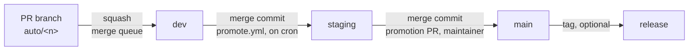
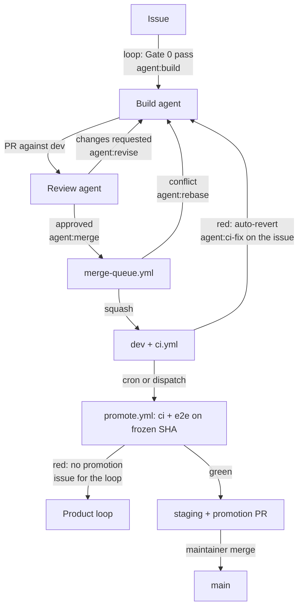

# CI/CD strategy

> **Status:** Proposed. Becomes binding when merged by the maintainer, together with
> [DECISIONS.md D-07](../product/DECISIONS.md).
> **Revision:** 2026-11-20 · measured against `main` @ `372755d3`
> **Read with:** [VISION.md](../product/VISION.md) §4 (the update guarantees this serves) ·
> [ADMISSION.md](../product/ADMISSION.md) (the per-change gate) ·
> [COMPLIANCE-CHECKLIST.md](COMPLIANCE-CHECKLIST.md) (how to check an implementation of this
> document)

This document defines how a change moves from an issue to a release: the branches, who writes
each one, the checks at each step, and the work each actor does. It is the contract that
agents, workflows and the maintainer are reviewed against.

---

## 1. Goals and constraints

| # | Goal | Why |
|---|---|---|
| G1 | The maintainer reviews **one promotion per cadence**, not one PR per change | The maintainer is the only person in the loop. When every PR waits for a person, PRs go stale (94 open on 2026-11-20, 75 older than 14 days) |
| G2 | Each PR's gate is cheap: admission review and fast checks | Expensive verification (e2e, click-through) runs once per batch |
| G3 | `main` history is never rewritten | Adopters take updates from `main` (VISION §4.1). Rewritten history turns each update into conflicts |
| G4 | Every release is a list of slices, one area each, each with one release-note line | VISION §4.3. Squash-per-PR makes this a `git log` query |
| G5 | Any single change can be removed with one `git revert` | A failed slice is removed without blocking the rest of the batch |
| G6 | Machine steps run in workflows; judgement steps run in agents | Deterministic steps (merge, revert, promote) behave the same every time and cost no agent run |

Constraints measured on 2026-11-20:

- The repository is private on a GitHub Free personal account. Branch protection and rulesets
  return `403`. Nothing in this document can be enforced by GitHub until §8 (Stage 2).
- Every actor (maintainer, fleet agents, product loop) authenticates as the same GitHub user,
  through the maintainer's PAT.
- `ci.yml` runs 6 jobs, ~8 minutes wall time and ~11 billed minutes per run. Actions minutes
  are metered while the repository is private.
- `e2e.yml` runs only on pushes to `main` and on manual dispatch. No change is e2e-tested before
  it reaches `main`.
- `.agents/review_pr.md` §7 merges approved PRs with `gh pr merge --merge`, and
  `.agents/work-on-issues.md` §8 opens PRs against the default branch (`main`).

---

## 2. Branch model



| Branch | Holds | Written by | Merge method | Gate into it |
|---|---|---|---|---|
| `auto/<n>` | one change for one issue | the fleet agent that owns the issue | commits, force-push allowed | — |
| `dev` | approved changes, integrated | the merge queue only (§4.3) | **squash**, one commit per PR | approval at head SHA, PR checks green, `dev` green |
| `staging` | the release candidate | `promote.yml` only (§4.5) | **merge commit** from a frozen `dev` SHA | full CI + e2e on that SHA |
| `main` | what adopters pull | the maintainer only | **merge commit** via the promotion PR | maintainer merge, after an optional click-through |

Rules:

1. **One writer per branch.** No agent pushes to `dev`, `staging` or `main`. No person pushes to
   `dev` or `staging`.
2. **`main` stays the default branch.** "Use this template" and the seed path (VISION §4.4) copy
   the default branch, so it must hold only promoted work. Agents set `--base dev` explicitly.
3. **No fix is committed to `staging` or `main`.** A fix lands on `dev` as a normal PR and is
   promoted. A commit made only on `staging` makes it diverge from `dev`, and the next promotion
   conflicts.
4. **`main` and `staging` are never force-pushed or rebased.** `dev` is not rewritten either;
   a bad change is removed with `git revert`.
5. **Merge commits above `dev`.** `git log --first-parent main` lists promotions;
   `git log --no-merges main` lists slices.

---

## 3. Actors

| Actor | What it is | Decides | Never |
|---|---|---|---|
| **Maintainer** | the repository owner | `DECISIONS.md` items (ADMISSION §5); merges each promotion PR into `main`; tags releases | merges fleet PRs one by one |
| **Product loop** | the scheduled product-manager run on Multica (MUN-21), every 4 h | what is dispatched (Gate 0); WIP limits; reverts a slice that fails integration review; reports | writes code; merges into `main` |
| **Fleet: build** | agents triggered by `agent:build` / `agent:spec` | how an admitted issue is implemented | merges anything; pushes to a protected branch; rebases a branch it did not create |
| **Fleet: review** | agents triggered by `agent:review` | whether a PR passes ADMISSION Gates 0–4 and code review | merges anything |
| **Fleet: ci-fix / revise / rebase** | agents triggered by the label of the same name | the fix for one named problem on one PR | resolves another PR's conflicts |
| **Merge queue** | `merge-queue.yml` (§4.3) | nothing; it applies fixed rules | uses judgement; skips a check |
| **Promotion** | `promote.yml` (§4.5) | nothing; it applies fixed rules | promotes an unverified SHA |

---

## 4. The pipeline, stage by stage



### 4.1 Dispatch — product loop

Unchanged from the current loop brief: an issue that passes Gate 0 gets `agent:build` (or
`agent:spec`) and the dispatch assignee, with the gate verdict and acceptance criteria in a
comment. Added rules:

- **WIP limit.** If 20 or more PRs are open against `dev`, the run dispatches nothing and reports
  the queue instead.
- **Staleness.** A PR with no commit and no review for 48 hours gets `backlog` and a comment.
  It is not closed.

### 4.2 Build and review — fleet

- Branch from `dev`; open the PR with `--base dev`.
- One area per PR (ADMISSION Gate 2). The PR body carries two machine-read lines, in the
  existing **Release-note line** section of `.github/pull_request_template.md`:

  ```text
  Area: api
  Release-note: <one line an adopter reads to decide whether to take this change>
  ```

  `Area` is one of `api`, `web`, `db`, `infra`. A PR that spans areas states why, uses the
  dominant area, and lists the others in the release-note line.
- The review agent applies ADMISSION and code review. On approval it submits a GitHub review event (`APPROVE`) for the head SHA it approved and records the verdict line and SHA in its approval comment, then sets `agent:merge` and removes
  `in-progress`. **It does not merge.** In Stage 1 check 5 is advisory (all actors share one identity — see §7); in Stage 2 it requires the review event from an identity distinct from the PR author.
- A conflict on a PR goes back to the agent that built it (`agent:rebase`). It knows the intent;
  `agent:ci-fix` does not.

### 4.3 Merge into `dev` — `merge-queue.yml`

A workflow, not an agent, **living on `main`** so `schedule` and `workflow_run` fire (those triggers only evaluate on the default branch). Triggered on `labeled` (`agent:merge`), on completion of `ci` for
`dev` (`workflow_run`), and every 30 minutes as a fallback. `concurrency: merge-queue`
serializes it, so at most one merge is in flight.

Each run takes the oldest `P0`-labelled PR with `agent:merge` if any; otherwise the **oldest** PR labelled `agent:merge` (FIFO by label time) — so a `P0` security fix jumps the queue per §6 — and checks, in order:

| # | Check | On failure |
|---|---|---|
| 1 | The latest `ci` run on `dev` is for the current `dev` head, and it is green | exit; the next `workflow_run` retries |
| 2 | Base is `dev` | comment, retarget is the author's job → `agent:revise` |
| 3 | `mergeable == MERGEABLE` | `agent:rebase` |
| 4 | Every PR check at the head SHA is green | `agent:ci-fix` |
| 5 | A GitHub review event approves the current head SHA from an identity distinct from the PR author (Stage 1: advisory — see §7) | `agent:review` (the approval is stale or not a review event) |
| 6 | The PR body has one `Area:` line with a valid value | `agent:revise` |
| 7 | The PR body has one non-empty `Release-note:` line; when it is missing the merger writes it from the diff and merges anyway — a missing line never blocks a merge (ADMISSION Gate 2) | merger writes it; merge proceeds |

When all pass, it squash-merges with an explicit message, so the trailers reach `git log`
regardless of the repository's default squash message:

```bash
gh pr merge "$N" --squash \
  --subject "$TITLE (#$N)" \
  --body "$(printf 'Area: %s\nRelease-note: %s\n' "$AREA" "$NOTE")"
```

On any failure it swaps `agent:merge` for the label in the table, posts one comment naming
the failed check, and moves to the next PR.

After the merge it closes the PR's linked issues itself (`gh issue close` with a comment
naming the squash SHA). GitHub closes issues from `Closes #N` only when a PR merges into the
default branch, and `dev` is not the default branch.

**No rebase before merge.** GitHub's squash merge applies the PR onto the current `dev` tip;
check 3 stops textual conflicts. Semantic conflicts (both sides merge cleanly, the result is
broken) are caught by `ci` on `dev` in §4.4. This avoids re-running CI on every open PR each
time `dev` moves.

**Throughput ceiling.** One merge per `dev` CI run (~8 min) is ~150 merges a day. The busiest
day recorded is 38. If the queue holds above ~100 merges a day, merge in batches of N and
bisect on failure; until then that is not built.

### 4.4 Integration on `dev` — `ci.yml` + auto-revert

`ci.yml` runs on every push to `dev`. Because the merge queue waits for it (check 1), a red
`dev` run is caused by exactly one squash commit. The merge queue reruns the failed jobs once,
so a flaky test does not revert a correct change. If the rerun is still red, it:

1. `git revert` that commit on `dev` (direct push via the machine-user bypass — if no bypass is available, open a revert PR instead), subject `revert: <subject> — dev CI failed`, body keeping git's
   `This reverts commit <sha>.` line and the failed run URL;
2. reopens the issue it closed at merge, with `agent:ci-fix` and a link to the failed run;
3. continues with the next PR once `dev` is green.

The PR is not reopened; its branch is deleted on merge. The fix is a new PR for the same issue.

### 4.5 Promotion — `promote.yml`

Triggered on a cron (default **daily, 04:00 UTC = 06:00 SAST**) and on `workflow_dispatch`
(the expedite path, §6) — **lives on `main`** so the cron fires (GitHub only evaluates `schedule` on the default branch).

1. **Freeze.** Record the current `dev` head SHA. If `staging` already contains it, exit.
   Merges that land after this point go into the next promotion.
2. **Verify.** Call `ci.yml` and `e2e.yml` as reusable workflows (`workflow_call`) with `sha:` set to the frozen SHA, and each workflow checks out that SHA (`actions/checkout` with `ref: ${{ inputs.sha }}`) in every job. Nothing moves until both are green — without the pinned checkout the workflows would run at `main` and CICD-27 could pass without ever exercising the frozen SHA.
3. **On red:** do not touch `staging`. Open or update one issue `Promotion blocked at <sha>`
   with the failed run, labelled `agent:triage`, for the product loop.
4. **On green:**
   - merge the SHA into `staging` with a merge commit (`Promote dev@<sha7>`), pushed with
     `FLEET_TOKEN` so the push triggers workflows;
   - run `make release-notes BASE=main HEAD=staging`;
   - open the promotion PR `staging → main`, or update its body if one is open. A PR left
     unmerged accumulates later promotions; its body is regenerated each time. The PR is opened
     with `FLEET_TOKEN`, so `ci` and `e2e` run on it again; those runs are the required checks
     in Stage 2 (§8).

Promotion PR body:

```markdown
## Promotion dev@<sha7> → main

CI: <run url> · e2e: <run url>

## Slices
### api
- #1801 Release-note line…
### web
- …

## Click-through (optional)
make release-candidate SHA=<sha>
- [ ] #1801 <what to look at>
- [ ] …
```

### 4.6 Acceptance and release — maintainer

- Optionally run `make release-candidate SHA=<sha>` and work through the checklist.
- Merge the promotion PR with **Create a merge commit**.
- Decide whether to tag a release. The release notes are the promotion PR's slice list.
- A slice that fails click-through: comment on the promotion PR naming it. The product loop
  reverts it on `dev` (§4.4 message format), and the next promotion carries the revert.
  The rest of the promotion can still be merged if the failure is not blocking.

---

## 5. Labels

The PR state machine. Exactly one `agent:*` trigger label at a time.

| Label | Meaning | Set by | Cleared by |
|---|---|---|---|
| `agent:review` | needs a review verdict at the current head | build agent, merge queue (stale approval) | review agent |
| `agent:revise` | review requested changes | review agent, merge queue | build agent |
| `agent:rebase` | conflicts with `dev` | merge queue | the PR's own build agent |
| `agent:ci-fix` | a check is red, or the slice was reverted for a red `dev` | merge queue | ci-fix agent |
| `agent:merge` | approved; waiting in the merge queue | review agent | merge queue |
| `backlog` | deferred by Gate 0, or stale | product loop | maintainer |
| `needs-human` | an ADMISSION §5 decision | anyone | maintainer |

`agent:done` is no longer used on open PRs; `agent:merge` replaces its "ready to merge" meaning.

---

## 6. Expedite path

A security fix (VISION P6) or a broken `main` cannot wait for the next cron. The path is the
same pipeline, run immediately:

1. The fix is a normal PR against `dev` with `P0`. The merge queue takes `P0` before FIFO order.
2. After its `dev` CI is green, run `promote.yml` with `workflow_dispatch`. It promotes the
   whole current `dev` head, not a cherry-pick, so `staging` and `main` never diverge from `dev`.
3. The maintainer merges the promotion PR.

There is no direct push to `main`, including for hotfixes.

---

## 7. Stage 1 — running without enforcement

Stage 1 is the state this document is adopted in: private repository, no branch protection,
every actor using the maintainer's PAT. Every rule in §2–§6 is followed by convention.
Two things keep it checked:

**`branch-guard.yml`.** Runs on every push to `dev`, `staging` and `main` and fails, then opens
or updates a `needs-human` issue, when the pushed range breaks the branch model:

| Branch | Every new first-parent commit must be |
|---|---|
| `dev` | a single-parent commit whose message has `Area:` and `Release-note:` lines, or a `revert:` commit |
| `staging` | a merge commit whose second parent is a commit on `dev` |
| `main` | a merge commit whose second parent is the `staging` head at merge time |

Plus: no push may be a non-fast-forward (force push). This detects a violation within minutes;
it cannot prevent one. Stage 2 adds prevention.

**The product loop's audit.** Each run compares `dev`, `staging` and `main` against the rules
above and reports any guard failure.

**Secrets.** One repository secret, `FLEET_TOKEN`, used by `merge-queue.yml` and
`promote.yml`. In Stage 1 it holds the maintainer's PAT. It must be a PAT and not
`GITHUB_TOKEN`: pushes and PRs created with `GITHUB_TOKEN` do not trigger other workflows, so
`ci.yml` would not run on `dev` and the promotion would look verified when nothing ran.

**Approval in Stage 1.** §4.3 check 5 is advisory in Stage 1: every actor authenticates as the same user, so a comment-based SHA check cannot distinguish the review agent from the build agent. Stage 2 introduces a separate reviewer identity and check 5 then requires the review event; until then it gates only on the comment.

**Assignment.** Fleet work queries must name the dispatch assignee explicitly
(`--assignee kinged007`), not `@me`. Then Stage 2's token change does not change which issues
the fleet picks up, and no issue needs to be reassigned. The queries live in the Multica
autopilot prompts, not in this repository; changing them is a Stage 1 step.

---

## 8. Stage 2 — enforcement

Entered when the repository is made public (DECISIONS O-1). Each step works on its own.

1. **Fleet identity.** A machine user with write access, using a fine-grained PAT limited to
   this repository. `FLEET_TOKEN` and the agents' `GH_TOKEN` switch to it. A machine user is
   chosen over a GitHub App because issues are assigned as the dispatch handoff and an App
   cannot be an assignee. With §7's explicit assignee, dispatch is unaffected.
2. **Rulesets.**

   | Branch | Rules |
   |---|---|
   | `main` | require a PR; 1 approving review (the promotion PR is opened by the machine user, so the maintainer's approval is the required one); merge commits only; block force push and deletion; require `ci` and `e2e` |
   | `staging` | block force push and deletion; restrict updates to the machine user |
   | `dev` | require a PR; squash only; require `ci`; block force push and deletion; allow the machine user to bypass (Stage 2) so §4.4's auto-revert can push `git revert` directly — without a bypass the revert fails and check 1 stalls the queue permanently |

   Personal-account repositories have fewer ruleset options than organisation repositories
   (push restrictions and bypass lists are limited). Verify each row at setup; where a rule is
   unavailable, `branch-guard.yml` remains the check for it.
3. **Repository settings.** `allow_rebase_merge=false` (rebase merges rewrite SHAs);
   `delete_branch_on_merge=true` — but exclude `staging` (or open promotions from a throwaway `promote/<sha7>` branch) before enabling it, otherwise the first promotion PR whose head is `staging` deletes `staging` on merge (Stage 1 has no deletion guard; only the Stage 2 `staging` ruleset blocks it).
4. **Stale branches.** Delete remote branches with no open PR (645 branches on 2026-11-20).

`branch-guard.yml` stays after Stage 2. It covers anything the rulesets on a personal account
cannot express.

---

## 9. What gets built

Built in this order. Each row is one PR against the branch named.

| # | Piece | Content | Depends on | Base |
|---|---|---|---|---|
| 1 | Branches + secret | create `dev` and `staging` at `main`; add `FLEET_TOKEN`; `delete_branch_on_merge=true`; `allow_rebase_merge=false` | — | settings, no PR |
| 2 | Fleet briefs | `work-on-issues.md` §8: `--base dev`. `review_pr.md` §7: approval sets `agent:merge` and records the approved SHA; no merge. PR template: `Area:` / `Release-note:` lines | 1 | `main` |
| 3 | CI triggers | `ci.yml`: `push` on `dev`, `staging`, `main`; `pull_request` on `dev` and `main`; `workflow_call` with `sha` input. `e2e.yml`: `workflow_call` with `sha` input; `pull_request` with base `main` | 1 | `main` |
| 4 | `make release-notes BASE= HEAD=` | `scripts/release-notes.sh`: read `Area:` / `Release-note:` from `git log --no-merges BASE..HEAD`, drop pairs where one commit's `This reverts commit <sha>.` line names the other; a revert whose target is outside the range is listed under `Reverted`; group by area, print markdown | 2 | `dev` |
| 5 | `merge-queue.yml` | §4.3 checks, squash with explicit message, auto-revert §4.4 — **lives on `main`** (GitHub evaluates `schedule` and `workflow_run` only on the default branch; a copy on `dev` never fires its 30-minute fallback or its `workflow_run` retry) | 2, 3 | `main` |
| 6 | `promote.yml` | §4.5; cron + `workflow_dispatch` — **lives on `main`** (same trigger reason; the cron promotion and `workflow_dispatch` expedite both fire from the default branch) | 3, 4 | `main` |
| 7 | `branch-guard.yml` | §7 rules | 1 | `dev` |
| 8 | `make release-candidate SHA=` | worktree at SHA, `make setup`, `make db-check`, seed, run the app, print the latest promotion checklist; documented in `docs/OPERATIONS.md` | 4 | `dev` |
| 9 | Retarget open PRs | `gh pr edit <n> --base dev` for every open PR not in `backlog` | 1, 2 | — |
| 10 | Autopilot prompts | explicit assignee (§7); loop brief: WIP limit, staleness, audit, reverts, no merging | 2 | Multica, not this repo |

Pieces 2 and 3 target `main`, because the fleet and CI read their configuration from the
branch that runs them; until 2 and 3 land, `dev` does not exist as a working base. After 2 and 3 land, fast-forward `dev` (and `staging`) to that `main` head as an explicit step before piece 4, so `dev` carries the updated `ci.yml` (`push` on `dev`), the `--base dev` briefs and the template lines — otherwise `dev` never receives them and check 1 can never see a `ci` run for the current `dev` head. From piece 4 onward, everything goes through the pipeline it builds.

Stage 2 (§8) is separate and has no code beyond ruleset settings.

**Gate 0.** Pieces 4, 6 and 8 deliver VISION §4.3 (release slicing) and the §6 measure
"`make setup` → running app, clean machine, measured each release". The rest is the tooling
the phase is delivered with, admitted on the same basis as the fleet-brief change in #1798.

**Not built:** a hosted preview environment (piece 8 covers the click-through on a local
machine until it does not); a CI split into fast and full jobs (the ~8 minute run is within the
§4.3 ceiling); a third-party merge-queue service.

---

## 10. Failure modes

| Failure | Detected by | Result | Recovery |
|---|---|---|---|
| Two PRs merge cleanly but break each other | `ci` on `dev` | the second is auto-reverted | its issue gets `agent:ci-fix` |
| A slice passes CI and e2e but is wrong in use | maintainer click-through | not merged to `main` yet | loop reverts on `dev`; next promotion |
| e2e flakes | `promote.yml` | no promotion that cycle | `Promotion blocked` issue; rerun with `workflow_dispatch` |
| An agent pushes to `dev`, `staging` or `main` | `branch-guard.yml` | red run + `needs-human` issue | maintainer reverts the push with a new commit; never force-push |
| `FLEET_TOKEN` expires | merge queue and promotion fail to push | queue stops; nothing is merged unverified | rotate the secret |
| The merge queue workflow is broken | PRs stay at `agent:merge` | no merges | the loop reports queue age; fix the workflow on `main` |
| A promotion PR is left unmerged | the PR's age | later promotions add to it | none needed; it is one PR whatever its size |

---

## 11. Upgrade paths

| Limit | Signal | Next step |
|---|---|---|
| One merge per `dev` CI run | queue wait > 4 h on most days | batch merges with bisect on failure |
| ~8 min CI per merge | the above, after batching | split `ci.yml` into a ≤2 min required job and a full job on `dev` |
| Click-through on a local machine | the maintainer stops doing it | deploy `staging` to a hosted preview on each promotion |
| Daily cadence | promotions regularly > 15 slices | shorten the cron |
